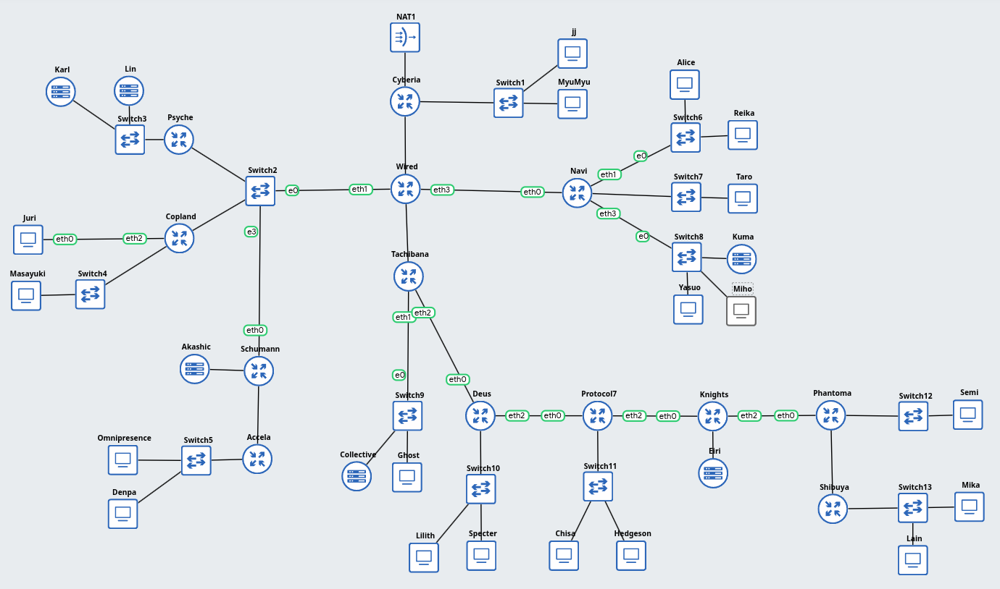
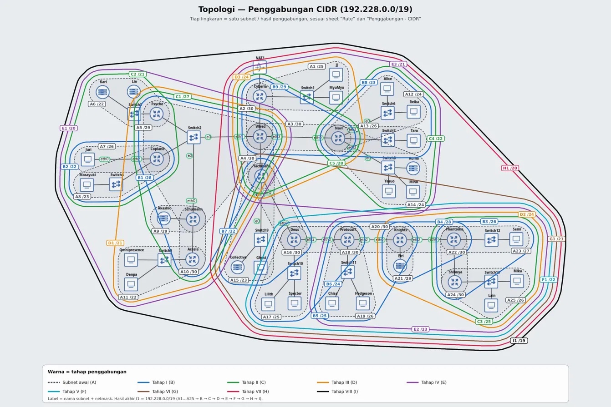

# PRAKTIKUM JARKOM MODUL 4 KELOMPOK K-34 - 2026

## Anggota Kelompok

| No | Nama | NRP |
| :---: | :--- | :--- |
| 1 | Muhammad Syadzili Abdul Muhyi | 5027251030 |
| 2 | Bambang Nasarillah Kurniawan | 5027251110 |

## Dokumen & File Praktikum

- **File CPT**: [`K-34-CPT-VLSM-.pkt`](./K-34-CPT-VLSM-.pkt)
- **Spreadsheet Perhitungan CIDR & VLSM**: [Google Spreadsheet K-34](https://docs.google.com/spreadsheets/d/1ZsvRJBebb4XmUBrfPrN1W4d9o1MQmDzJ5wA2ljYofLs/edit?usp=sharing)
- **Script Modular Node**: [`routings/gns3/`](./routings/gns3/)

---

### Bagian I: Cisco Packet Tracer (CPT) - VLSM

Pada bagian simulasi Cisco Packet Tracer diterapkan metode **VLSM (Variable Length Subnet Mask)**. Seluruh skema pengalamatan, konfigurasi interface router Cisco, switch, serta host PC telah diimplementasikan pada file project [`K-34-CPT-VLSM-.pkt`](./K-34-CPT-VLSM-.pkt).

Perhitungan rinci kebutuhan IP, netmask VLSM per subnet, range usable IP, serta pengujian konektivitas antarnode tercantum dalam [Google Spreadsheet](https://docs.google.com/spreadsheets/d/1ZsvRJBebb4XmUBrfPrN1W4d9o1MQmDzJ5wA2ljYofLs/edit?usp=sharing) pada sheet **"Pembagian IP - VLSM"**.

---

### Bagian II: GNS3 - CIDR ("The Wired Expansion")

Pada topologi GNS3 diterapkan metode **CIDR (Classless Inter-Domain Routing)** dengan prefix kelompok **`192.228.x.x`** dan Root Supernet **`192.228.0.0/19`**. Fokus utama implementasi CIDR adalah alokasi alamat efisien, perataan boundary subnet, dan hierarki agregasi rute (*route summarization*) tanpa adanya overlap antarsubnet.

---

### 1. Topologi Jaringan GNS3

Topologi "The Wired Expansion" terdiri dari **13 Router, 13 Switch, dan 25 Host / End Device** (total 38 perangkat aktif). Jaringan berpusat pada Router Gateway **`Cyberia`** dan Router Backbone **`Wired`**, yang kemudian bercabang ke tiga sayap utama:



- **Gateway Internet & LAN Atas**:
  - **`Cyberia`**: Terhubung ke `NAT1` (akses WAN internet) melalui `eth0`, ke LAN client (`JJ`, `MyuMyu` via `Switch1`), dan ke backbone **`Wired`**.
- **Backbone Router**:
  - **`Wired`**: Berperan sebagai pusat transit trafik antarsayap dan default gateway internal ke arah Cyberia.
- **Sayap Kiri (Multi-access Switch2)**:
  - Hub `Switch2` menghubungkan **`Wired`**, **`Psyche`**, **`Copland`**, dan **`Schumann`**.
  - **`Psyche`** membawahi `Switch3` (`Karl` dan `Lin` — blok terbesar 881 IP, Subnet A1).
  - **`Copland`** membawahi `Switch4` (`Masayuki` — 301 IP, Subnet A3) serta direct link ke host **`Juri`** (32 IP, Subnet A12).
  - **`Schumann`** membawahi direct host **`Akashic`** (4 IP, Subnet A15) dan Router **`Accela`** (`Switch5` -> `Omnipresence` dan `Denpa` — 514 IP, Subnet A2).
- **Sayap Kanan (Router Navi)**:
  - **`Navi`** membawahi 3 subnet LAN: `Switch6` (`Alice`, `Reika` — Subnet A5), `Switch7` (`Taro` — Subnet A10), dan `Switch8` (`Yasuo`, `Miho`, `Kuma` — Subnet A6).
- **Sayap Bawah (Rantai Router Tachibana s/d Shibuya)**:
  - Rantai serial 6 router: **`Tachibana`** $	o$ **`Deus`** $	o$ **`Protocol7`** $	o$ **`Knights`** $	o$ **`Phantoma`** $	o$ **`Shibuya`**.
  - Setiap router memiliki segmen LAN masing-masing (`Switch9` s/d `Switch13` serta server direct `Eiri` pada Knights).

---

### 2. Tabel Pembagian IP (CIDR Subnetting Table)

Berdasarkan sheet **"Rute"** dan **"Pembagian IP - CIDR"** terbaru, total kebutuhan pengalamatan The Wired adalah **2814 IP**. Subnet diurutkan dari kebutuhan IP terbesar ke terkecil (**A1 - A25**) dengan alokasi prefix dasar **`192.228.x.x`**:

| Subnet | Jalur / Rute | Kebutuhan IP | Netmask | Network ID | Range Usable IP | Broadcast |
| :---: | :--- | :---: | :---: | :---: | :---: | :---: |
| **A1** | Psyche > Switch3 > Karl, Lin | 881 | `/22` (`255.255.252.0`) | `192.228.8.0` | `192.228.8.1 - 192.228.11.254` | `192.228.11.255` |
| **A2** | Accela > Switch5 > Omnipresence, Denpa | 514 | `/22` (`255.255.252.0`) | `192.228.0.0` | `192.228.0.1 - 192.228.3.254` | `192.228.3.255` |
| **A3** | Copland > Switch4 > Masayuki | 301 | `/23` (`255.255.254.0`) | `192.228.12.0` | `192.228.12.1 - 192.228.13.254` | `192.228.13.255` |
| **A4** | Tachibana > Switch9 > Collective, Ghost | 267 | `/23` (`255.255.254.0`) | `192.228.20.0` | `192.228.20.1 - 192.228.21.254` | `192.228.21.255` |
| **A5** | Navi > Switch6 > Alice, Reika | 254 | `/24` (`255.255.255.0`) | `192.228.24.0` | `192.228.24.1 - 192.228.24.254` | `192.228.24.255` |
| **A6** | Navi > Switch8 > Yasuo, Miho, Kuma | 143 | `/24` (`255.255.255.0`) | `192.228.26.0` | `192.228.26.1 - 192.228.26.254` | `192.228.26.255` |
| **A7** | Cyberia > Switch1 > JJ, MyuMyu | 126 | `/25` (`255.255.255.128`) | `192.228.28.0` | `192.228.28.1 - 192.228.28.126` | `192.228.28.127` |
| **A8** | Deus > Switch10 > Lilith, Specter | 99 | `/25` (`255.255.255.128`) | `192.228.18.0` | `192.228.18.1 - 192.228.18.126` | `192.228.18.127` |
| **A9** | Shibuya > Switch13 > Lain, Mika | 62 | `/26` (`255.255.255.192`) | `192.228.16.0` | `192.228.16.1 - 192.228.16.62` | `192.228.16.63` |
| **A10** | Navi > Switch7 > Taro | 58 | `/26` (`255.255.255.192`) | `192.228.25.0` | `192.228.25.1 - 192.228.25.62` | `192.228.25.63` |
| **A11** | Protocol7 > Switch11 > Chisa, Hodgson | 33 | `/26` (`255.255.255.192`) | `192.228.17.0` | `192.228.17.1 - 192.228.17.62` | `192.228.17.63` |
| **A12** | Copland > Juri (Direct) | 32 | `/26` (`255.255.255.192`) | `192.228.14.0` | `192.228.14.1 - 192.228.14.62` | `192.228.14.63` |
| **A13** | Phantoma > Switch12 > Semi | 15 | `/27` (`255.255.255.224`) | `192.228.16.64` | `192.228.16.65 - 192.228.16.94` | `192.228.16.95` |
| **A14** | Wired > Switch2 > Psyche, Copland, Schumann | 4 | `/29` (`255.255.255.248`) | `192.228.4.0` | `192.228.4.1 - 192.228.4.6` | `192.228.4.7` |
| **A15** | Schumann > Akashic (Direct) | 4 | `/29` (`255.255.255.248`) | `192.228.4.16` | `192.228.4.17 - 192.228.4.22` | `192.228.4.23` |
| **A16** | Knights > Eiri (Direct) | 3 | `/29` (`255.255.255.248`) | `192.228.16.128` | `192.228.16.129 - 192.228.16.134` | `192.228.16.135` |
| **A17** | Cyberia > Wired | 2 | `/30` (`255.255.255.252`) | `192.228.28.128` | `192.228.28.129 - 192.228.28.130` | `192.228.28.131` |
| **A18** | Wired > Navi | 2 | `/30` (`255.255.255.252`) | `192.228.28.132` | `192.228.28.133 - 192.228.28.134` | `192.228.28.135` |
| **A19** | Wired > Tachibana | 2 | `/30` (`255.255.255.252`) | `192.228.28.136` | `192.228.28.137 - 192.228.28.138` | `192.228.28.139` |
| **A20** | Schumann > Accela | 2 | `/30` (`255.255.255.252`) | `192.228.4.8` | `192.228.4.9 - 192.228.4.10` | `192.228.4.11` |
| **A21** | Tachibana > Deus | 2 | `/30` (`255.255.255.252`) | `192.228.22.0` | `192.228.22.1 - 192.228.22.2` | `192.228.22.3` |
| **A22** | Deus > Protocol7 | 2 | `/30` (`255.255.255.252`) | `192.228.18.128` | `192.228.18.129 - 192.228.18.130` | `192.228.18.131` |
| **A23** | Protocol7 > Knights | 2 | `/30` (`255.255.255.252`) | `192.228.17.64` | `192.228.17.65 - 192.228.17.66` | `192.228.17.67` |
| **A24** | Knights > Phantoma | 2 | `/30` (`255.255.255.252`) | `192.228.16.136` | `192.228.16.137 - 192.228.16.138` | `192.228.16.139` |
| **A25** | Phantoma > Shibuya | 2 | `/30` (`255.255.255.252`) | `192.228.16.96` | `192.228.16.97 - 192.228.16.98` | `192.228.16.99` |

> [!NOTE]
> Seluruh 25 subnet di atas **100% non-overlapping** dan berada presisi di dalam batas Root Supernet **`192.228.0.0/19`** (`192.228.0.0` - `192.228.31.255`).

---

### 3. Perhitungan Penggabungan Rute (CIDR Supernetting)

Penggabungan rute dilakukan secara hierarkis (*bottom-up*) dari subnet terkecil hingga mencapai Root Supernet:

> [!NOTE]
> *(Diagram visual skema penggabungan CIDR terbaru akan diunggah menyusul)*

<!--  -->

#### Tahap I (Prefix Kelompok B)
- **B1**: A14 (`192.228.4.0/29`) + A20 (`192.228.4.8/30`) $	o$ **`192.228.4.0/28`** (Rentang: `4.0` - `4.15`)
- **B2**: A3 (`192.228.12.0/23`) + A12 (`192.228.14.0/26`) $	o$ **`192.228.12.0/22`** (Rentang: `12.0` - `15.255`)
- **B3**: A13 (`192.228.16.64/27`) + A25 (`192.228.16.96/30`) $	o$ **`192.228.16.64/26`** (Rentang: `16.64` - `16.127`)
- **B4**: A16 (`192.228.16.128/29`) + A24 (`192.228.16.136/30`) $	o$ **`192.228.16.128/28`** (Rentang: `16.128` - `16.143`)
- **B5**: A11 (`192.228.17.0/26`) + A23 (`192.228.17.64/30`) $	o$ **`192.228.17.0/25`** (Rentang: `17.0` - `17.127`)
- **B6**: A8 (`192.228.18.0/25`) + A22 (`192.228.18.128/30`) $	o$ **`192.228.18.0/24`** (Rentang: `18.0` - `18.255`)
- **B7**: A4 (`192.228.20.0/23`) + A21 (`192.228.22.0/30`) $	o$ **`192.228.20.0/22`** (Rentang: `20.0` - `23.255`)
- **B8**: A5 (`192.228.24.0/24`) + A10 (`192.228.25.0/26`) $	o$ **`192.228.24.0/23`** (Rentang: `24.0` - `25.255`)
- **B9**: A17 (`192.228.28.128/30`) + A18 (`192.228.28.132/30`) $	o$ **`192.228.28.128/29`** (Rentang: `28.128` - `28.135`)

#### Tahap II (Prefix Kelompok C)
- **C1**: B1 (`192.228.4.0/28`) + A15 (`192.228.4.16/29`) $	o$ **`192.228.4.0/27`**
- **C2**: A1 (`192.228.8.0/22`) + B2 (`192.228.12.0/22`) $	o$ **`192.228.8.0/21`**
- **C3**: A9 (`192.228.16.0/26`) + B3 (`192.228.16.64/26`) $	o$ **`192.228.16.0/25`**
- **C4**: B8 (`192.228.24.0/23`) + A6 (`192.228.26.0/24`) $	o$ **`192.228.24.0/22`**
- **C5**: B9 (`192.228.28.128/29`) + A19 (`192.228.28.136/30`) $	o$ **`192.228.28.128/28`**

#### Tahap III sampai VIII (Supernet Utama)
- **Tahap III (D)**:
  - **D1**: A2 (`192.228.0.0/22`) + C1 (`192.228.4.0/27`) $	o$ **`192.228.0.0/21`**
  - **D2**: C3 (`192.228.16.0/25`) + B4 (`192.228.16.128/28`) $	o$ **`192.228.16.0/24`**
  - **D3**: A7 (`192.228.28.0/25`) + C5 (`192.228.28.128/28`) $	o$ **`192.228.28.0/24`**
- **Tahap IV (E)**:
  - **E1**: D1 (`192.228.0.0/21`) + C2 (`192.228.8.0/21`) $	o$ **`192.228.0.0/20`** (Seluruh Sayap Kiri)
  - **E2**: D2 (`192.228.16.0/24`) + B5 (`192.228.17.0/25`) $	o$ **`192.228.16.0/23`**
  - **E3**: C4 (`192.228.24.0/22`) + D3 (`192.228.28.0/24`) $	o$ **`192.228.24.0/21`** (Sayap Kanan + Cyberia)
- **Tahap V (F)**:
  - **F1**: E2 (`192.228.16.0/23`) + B6 (`192.228.18.0/24`) $	o$ **`192.228.16.0/22`**
- **Tahap VI (G)**:
  - **G1**: F1 (`192.228.16.0/22`) + B7 (`192.228.20.0/22`) $	o$ **`192.228.16.0/21`** (Seluruh Sayap Bawah)
- **Tahap VII (H)**:
  - **H1**: G1 (`192.228.16.0/21`) + E3 (`192.228.24.0/21`) $	o$ **`192.228.16.0/20`** (Bawah + Kanan + Cyberia)
- **Tahap VIII (I - Root Supernet)**:
  - **I1 (Root Supernet)**: E1 (`192.228.0.0/20`) + H1 (`192.228.16.0/20`) $	o$ **`192.228.0.0/19`** (Mencakup seluruh jaringan The Wired).

---

### 4. Konfigurasi Routing & Pengalamatan Node

#### A. Config Router (Interface Router)
Format: `ke <Tujuan / Subnet> (<Interface>) -> <IP Address> -> <Netmask>`

**Cyberia**
ke Cloud / NAT1 (eth0) -> DHCP / IP dari ISP
ke Switch1 / Subnet A7 (eth1) -> 192.228.28.1 -> 255.255.255.128
ke Wired / Subnet A17 (eth2) -> 192.228.28.129 -> 255.255.255.252

**Wired**
ke Cyberia / Subnet A17 (eth0) -> 192.228.28.130 -> 255.255.255.252
ke Switch2 / Subnet A14 (eth1) -> 192.228.4.1 -> 255.255.255.248
ke Tachibana / Subnet A19 (eth2) -> 192.228.28.137 -> 255.255.255.252
ke Navi / Subnet A18 (eth3) -> 192.228.28.133 -> 255.255.255.252

**Navi**
ke Wired / Subnet A18 (eth0) -> 192.228.28.134 -> 255.255.255.252
ke A5 / Switch6 (eth1) -> 192.228.24.1 -> 255.255.255.0
ke A10 / Switch7 (eth2) -> 192.228.25.1 -> 255.255.255.192
ke A6 / Switch8 (eth3) -> 192.228.26.1 -> 255.255.255.0

**Tachibana**
ke Wired / Subnet A19 (eth0) -> 192.228.28.138 -> 255.255.255.252
ke A4 / Switch9 (eth1) -> 192.228.20.1 -> 255.255.254.0
ke Deus / Subnet A21 (eth2) -> 192.228.22.1 -> 255.255.255.252

**Deus**
ke Tachibana / Subnet A21 (eth0) -> 192.228.22.2 -> 255.255.255.252
ke A8 / Switch10 (eth1) -> 192.228.18.1 -> 255.255.255.128
ke Protocol7 / Subnet A22 (eth2) -> 192.228.18.129 -> 255.255.255.252

**Protocol7**
ke Deus / Subnet A22 (eth0) -> 192.228.18.130 -> 255.255.255.252
ke A11 / Switch11 (eth1) -> 192.228.17.1 -> 255.255.255.192
ke Knights / Subnet A23 (eth2) -> 192.228.17.65 -> 255.255.255.252

**Knights**
ke Protocol7 / Subnet A23 (eth0) -> 192.228.17.66 -> 255.255.255.252
ke A16 / Eiri (eth1) -> 192.228.16.129 -> 255.255.255.248
ke Phantoma / Subnet A24 (eth2) -> 192.228.16.137 -> 255.255.255.252

**Phantoma**
ke Knights / Subnet A24 (eth0) -> 192.228.16.138 -> 255.255.255.252
ke A13 / Switch12 (eth1) -> 192.228.16.65 -> 255.255.255.224
ke Shibuya / Subnet A25 (eth2) -> 192.228.16.97 -> 255.255.255.252

**Shibuya**
ke Phantoma / Subnet A25 (eth0) -> 192.228.16.98 -> 255.255.255.252
ke A9 / Switch13 (eth1) -> 192.228.16.1 -> 255.255.255.192

**Psyche**
ke Switch2 / Subnet A14 (eth0) -> 192.228.4.2 -> 255.255.255.248
ke A1 / Switch3 (eth1) -> 192.228.8.1 -> 255.255.252.0

**Copland**
ke Switch2 / Subnet A14 (eth0) -> 192.228.4.3 -> 255.255.255.248
ke A3 / Switch4 (eth1) -> 192.228.12.1 -> 255.255.254.0
ke A12 / Juri (eth2) -> 192.228.14.1 -> 255.255.255.192

**Schumann**
ke Switch2 / Subnet A14 (eth0) -> 192.228.4.4 -> 255.255.255.248
ke A15 / Akashic (eth1) -> 192.228.4.17 -> 255.255.255.248
ke Accela / Subnet A20 (eth2) -> 192.228.4.9 -> 255.255.255.252

**Accela**
ke Schumann / Subnet A20 (eth0) -> 192.228.4.10 -> 255.255.255.252
ke A2 / Switch5 (eth1) -> 192.228.0.1 -> 255.255.252.0

---

#### B. CONFIG HOST
Format: `NODE -> IP ADDRESS -> NETMASK -> DEFAULT GATEWAY`

**Area Router Psyche (Subnet A1)**
Karl -> 192.228.8.2 -> 255.255.252.0 -> 192.228.8.1  
Lin -> 192.228.8.3 -> 255.255.252.0 -> 192.228.8.1  

**Area Router Accela (Subnet A2)**
Omnipresence -> 192.228.0.2 -> 255.255.252.0 -> 192.228.0.1  
Denpa -> 192.228.0.3 -> 255.255.252.0 -> 192.228.0.1  

**Area Router Copland (Subnet A3 & A12)**
Masayuki (A3) -> 192.228.12.2 -> 255.255.254.0 -> 192.228.12.1  
Juri (A12) -> 192.228.14.2 -> 255.255.255.192 -> 192.228.14.1  

**Area Router Tachibana (Subnet A4)**
Collective -> 192.228.20.2 -> 255.255.254.0 -> 192.228.20.1  
Ghost -> 192.228.20.3 -> 255.255.254.0 -> 192.228.20.1  

**Area Router Navi (Subnet A5, A6 & A10)**
Alice (A5) -> 192.228.24.2 -> 255.255.255.0 -> 192.228.24.1  
Reika (A5) -> 192.228.24.3 -> 255.255.255.0 -> 192.228.24.1  
Yasuo (A6) -> 192.228.26.2 -> 255.255.255.0 -> 192.228.26.1  
Miho (A6) -> 192.228.26.3 -> 255.255.255.0 -> 192.228.26.1  
Kuma (A6) -> 192.228.26.4 -> 255.255.255.0 -> 192.228.26.1  
Taro (A10) -> 192.228.25.2 -> 255.255.255.192 -> 192.228.25.1  

**Area Router Cyberia (Subnet A7)**
JJ -> 192.228.28.2 -> 255.255.255.128 -> 192.228.28.1  
MyuMyu -> 192.228.28.3 -> 255.255.255.128 -> 192.228.28.1  

**Area Router Deus (Subnet A8)**
Lilith -> 192.228.18.2 -> 255.255.255.128 -> 192.228.18.1  
Specter -> 192.228.18.3 -> 255.255.255.128 -> 192.228.18.1  

**Area Router Shibuya (Subnet A9)**
Lain -> 192.228.16.2 -> 255.255.255.192 -> 192.228.16.1  
Mika -> 192.228.16.3 -> 255.255.255.192 -> 192.228.16.1  

**Area Router Protocol7 (Subnet A11)**
Chisa -> 192.228.17.2 -> 255.255.255.192 -> 192.228.17.1  
Hodgeson -> 192.228.17.3 -> 255.255.255.192 -> 192.228.17.1  

**Area Router Phantoma (Subnet A13)**
Semi -> 192.228.16.66 -> 255.255.255.224 -> 192.228.16.65  

**Area Router Schumann (Subnet A15)**
Akashic -> 192.228.4.18 -> 255.255.255.248 -> 192.228.4.17  

**Area Router Knights (Subnet A16)**
Eiri -> 192.228.16.130 -> 255.255.255.248 -> 192.228.16.129  

---

#### C. Routing di Semua Router

##### 1. Routing Dinamis OSPF (Cisco IOS / Cisco Packet Tracer):
Pada konfigurasi router Cisco IOS, routing OSPF diaktifkan untuk network root supernet `192.228.0.0/19` (Wildcard: `0.0.31.255`):
```cisco
enable
conf t
router ospf 1
 network 192.228.0.0 0.0.31.255 area 0
 exit
exit
wr
```
*(Catatan: Dapat juga menggunakan wildcard `0.0.255.255` untuk mencakup seluruh prefix `192.228.x.x`)*.

##### 2. Routing Statis CIDR (GNS3 Linux Node):
Diimplementasikan secara modular pada skrip [`routings/gns3/`](./routings/gns3/):
- **Gateway Cyberia**:
  ```bash
  ip route add 192.228.0.0/19 via 192.228.28.130
  iptables -t nat -A POSTROUTING -o eth0 -j MASQUERADE
  ```
- **Backbone Wired**:
  ```bash
  ip route add default via 192.228.28.129
  ip route add 192.228.24.0/22 via 192.228.28.134   # Sayap Kanan (Navi)
  ip route add 192.228.16.0/21 via 192.228.28.138   # Sayap Bawah (Tachibana)
  ip route add 192.228.8.0/22  via 192.228.4.2      # Sayap Kiri (Psyche)
  ip route add 192.228.12.0/22 via 192.228.4.3      # Sayap Kiri (Copland)
  ip route add 192.228.0.0/21  via 192.228.4.4      # Sayap Kiri (Schumann & Accela)
  ```
- **Router Cabang & Sayap Bawah**:
  Masing-masing router menambahkan default route ke arah uplink router dan rute supernet ke arah downstream sesuai hirarki CIDR.

---

### 5. Panduan Pengujian Konektivitas (Testing Matrix)

1. **Uji Internet Gateway pada `Cyberia`**:
   - `ping -c 3 8.8.8.8` (0% packet loss ke internet melalui NAT1).
2. **Uji Backbone pada `Wired`**:
   - `ping -c 3 192.228.28.129` (Ke Gateway Cyberia).
   - `ping -c 3 8.8.8.8` (Ke Internet melalui Cyberia).
3. **Uji Client LAN Cyberia (`JJ`)**:
   - `ping -c 3 192.228.28.1` (Ke Gateway Cyberia).
   - `ping -c 3 192.228.28.3` (Ke sesama client MyuMyu).
   - `ping -c 3 8.8.8.8` (Ke Internet).
4. **Uji Lintas Sayap (Cross-Wing Ping dari `Alice` di Sayap Kanan)**:
   - `ping -c 3 192.228.24.1` (Ke Gateway Navi).
   - `ping -c 3 192.228.26.4` (Ke host Kuma di sayap kanan).
   - `ping -c 3 192.228.0.2` (Menyeberang ke Omnipresence di sayap kiri).
   - `ping -c 3 192.228.28.2` (Menyeberang ke JJ di LAN Cyberia).
   - `ping -c 3 8.8.8.8` (Ke Internet).
5. **Uji Simpul Terdalam (Host `Lain` di Ujung Sayap Bawah)**:
   - `ping -c 3 192.228.16.1` (Ke Gateway lokal Shibuya).
   - `ping -c 3 192.228.16.3` (Ke tetangga Mika).
   - `ping -c 3 192.228.16.130` (Ke server Eiri di router Knights).
   - `ping -c 3 192.228.8.2` (Melintasi 8 router ke host Karl di Sayap Kiri).
   - `ping -c 3 8.8.8.8` (Melintasi 7 hop router tembus ke Internet publik).
